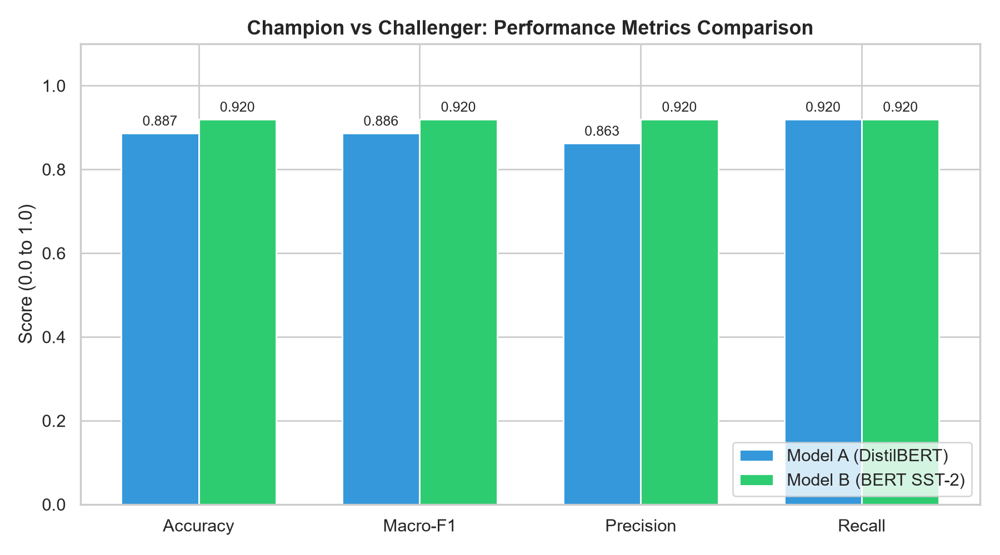
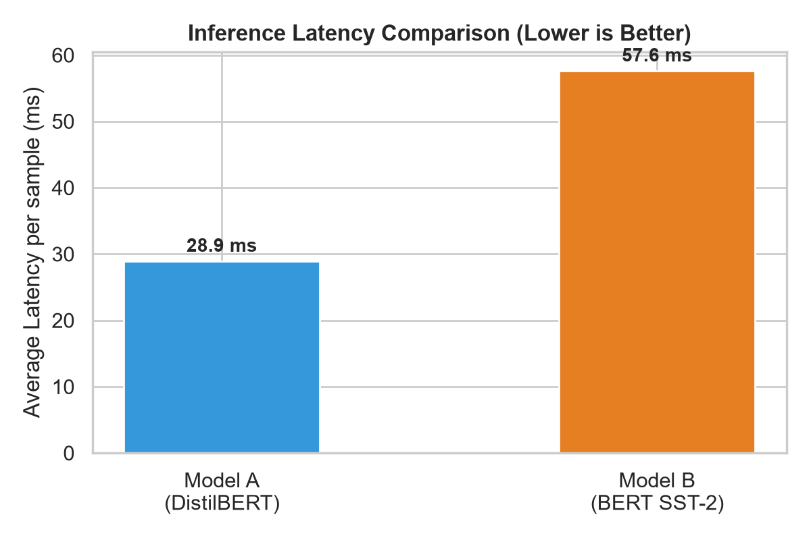
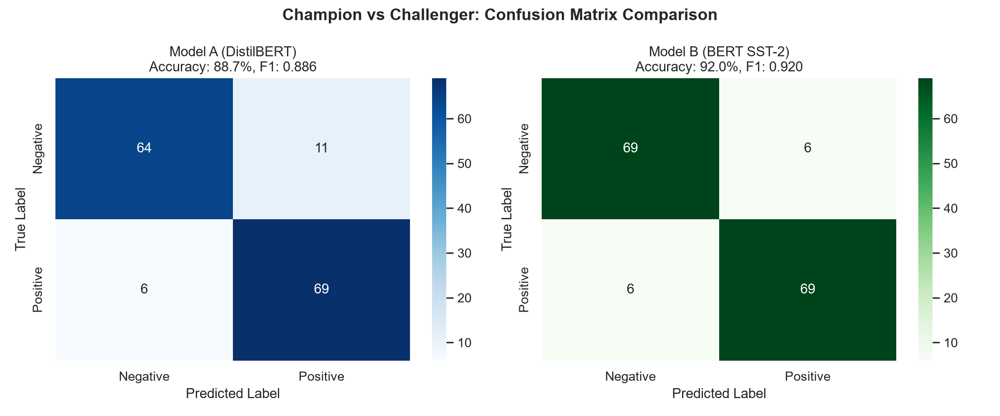
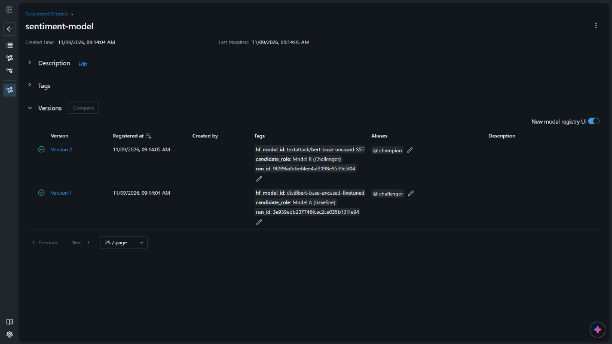
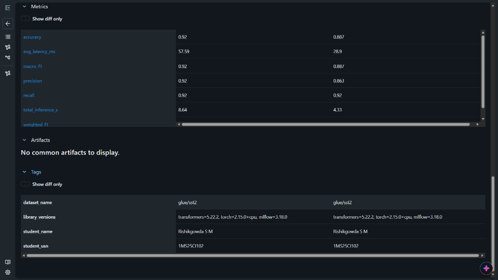
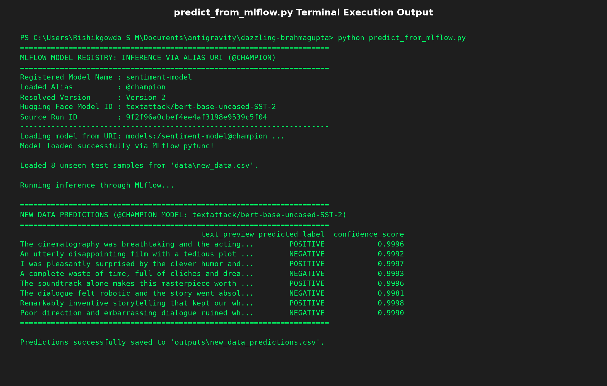

# Champion–Challenger Model Comparison with Hugging Face and MLflow

| | |
|---|---|
| **Name** | Rishikgowda S M |
| **USN** | 1MS25CI102 |
| **Branch** | CSE(AI&ML)|
| **Section** | B  |
| **Course** | Skill Lab (MLOps with MLflow) `[CISL-1]` |
| **Experiment Name** | `hf-sentiment-champion-challenger` |
| **Registered Model** | `sentiment-model` |

---

## 📌 Project Overview

In this project, I built an end-to-end MLOps evaluation and model governance pipeline comparing two pre-trained Hugging Face transformer models for **Binary Sentiment Classification** on the Stanford Sentiment Treebank (`sst2`) benchmark. 

The goal was to test whether a heavier **Challenger model** achieves a sufficient performance improvement over a fast, lightweight **Champion baseline** to justify its extra computational overhead, following a pre-declared decision rule with a strict latency guardrail.

```
                    ┌─────────────────────────┐
                    │ 150 Balanced SST-2 Rows │
                    └────────────┬────────────┘
                                 │
                 ┌───────────────┴───────────────┐
                 ▼                               ▼
       Model A (Baseline)               Model B (Challenger)
     DistilBERT (~67M params)          BERT Base (~110M params)
                 │                               │
                 └───────────────┬───────────────┘
                                 │
                                 ▼
                     ┌───────────────────────┐
                     │ MLflow Tracking Store │
                     │   (sqlite:///mlflow)  │
                     └───────────┬───────────┘
                                 │
                   Pre-Declared Decision Check:
               Δ(Macro-F1) ≥ +0.01 & Latency ≤ 2.0x
                                 │
                                 ▼
                ╔═════════════════════════════════╗
                ║   Promote Model B to @champion  ║
                ║   Demote  Model A to @challenger║
                ╚═════════════════════════════════╝
                                 │
                                 ▼
                     ┌───────────────────────┐
                     │ Standalone Inference  │
                     │ models:/sentiment-... │
                     │       @champion       │
                     └───────────────────────┘
```

---

## 🎯 Model Selection: Classification Pairing (1 vs 3)

Following the course guidelines, I chose **Classification Pairing (1 vs 3)** to balance evaluation rigor with practical local execution:

| Role | Model Architecture | Hugging Face Model ID | Parameters | Disk Size | Rationale |
| :--- | :--- | :--- | :---: | :---: | :--- |
| **Model A (Baseline Champion)** | DistilBERT Base Uncased | `distilbert-base-uncased-finetuned-sst-2-english` | ~67M | ~268 MB | Fast, distilled 6-layer transformer baseline; ideal for low-latency CPU inference. |
| **Model B (Challenger)** | BERT Base Uncased | `textattack/bert-base-uncased-SST-2` | ~110M | ~440 MB | 12-layer model with greater syntactic capacity to handle complex negations. Outputs raw `LABEL_0`/`LABEL_1` tokens, requiring custom label normalization. |

### Why this pairing works best:
1. **Low Footprint & CPU Friendly**: Both models stay below 450 MB, running fast on CPU without needing GPU hardware or excessive RAM.
2. **Label Normalization Handling**: Model B returns `LABEL_0`/`LABEL_1` while Model A returns `NEGATIVE`/`POSITIVE`. I implemented a custom PyFunc wrapper ([`hf_model_wrapper.py`](hf_model_wrapper.py)) to map them into a uniform schema.

---

## ⚖️ Pre-Declared Champion Rule

To prevent bias, the evaluation rule was declared before inspecting final experimental outputs:

1. **Primary Metric**: **Macro-F1** (harmonic mean of Precision and Recall averaged across positive and negative classes; higher is better).
2. **Minimum Improvement Margin**: The Challenger must beat the Baseline Champion by **$\Delta \ge +0.01$ (+1.0 percentage point)** in Macro-F1.
3. **Latency Guardrail**: The Challenger's average per-sample latency must **not exceed $2.0\times$** the Champion's latency ($Latency_B \le 2.0 \times Latency_A$).
4. **Tie-Breaker / Fallback**: If the Challenger fails either the +0.01 margin or the $2.0\times$ latency guardrail, Model A retains the `@champion` alias due to its speed and compact footprint.

---

## 🚀 Quickstart Guide

Clone the repository and run the entire pipeline in sequence:

### 1. Environment Setup
```powershell
# Clone the repository
git clone https://github.com/rishikgowda-nullstackdev/1MS25CI102-mlflow-champion-challenger.git
cd 1MS25CI102-mlflow-champion-challenger

# Create & activate a virtual environment
py -3.12 -m venv .venv
.venv\Scripts\Activate.ps1

# Install dependencies
pip install -r requirements.txt
```

### 2. Run the Evaluation Pipeline
Evaluates both models on identical 150 balanced SST-2 samples (`data/eval_inputs.csv`), logs runs to MLflow, and generates evaluation plots:
```powershell
python evaluate.py
```

### 3. Evaluate Decision Rule & Assign Aliases
Compares runs against the pre-declared rule, registers both models under `sentiment-model`, and sets `@champion` and `@challenger` aliases:
```powershell
python register_champion.py
```

### 4. Run Standalone Inference via Alias URI
Loads the winning model dynamically through `models:/sentiment-model@champion` without any direct Hugging Face imports:
```powershell
python predict_from_mlflow.py
```

### 5. Launch the MLflow UI Dashboard
```powershell
mlflow ui --backend-store-uri sqlite:///mlflow.db --port 5000
```
Open `http://127.0.0.1:5000` in your browser to inspect runs, compare metrics, and explore registered model versions.

---

## 📊 Experimental Results

Both models were benchmarked on the identical 150-sample balanced dataset (`data/eval_inputs.csv`) under identical CPU execution conditions:

| Metric / Attribute | Model A (DistilBERT Baseline) | Model B (BERT Challenger) | Difference ($\Delta = B - A$) | Better Model |
| :--- | :---: | :---: | :---: | :---: |
| **Hugging Face ID** | `distilbert-base-uncased...` | `textattack/bert-base...` | — | — |
| **Model Parameters** | ~67M | ~110M | +43M (+64%) | Model A (Smaller) |
| **Accuracy** | 0.8867 (88.67%) | 0.9200 (92.00%) | +0.0333 (+3.33%) | **Model B** |
| **Macro-F1 (Primary)** | **0.8865** | **0.9200** | **+0.0335 (+3.35%)** | **Model B** |
| **Precision** | 0.8625 | 0.9200 | +0.0575 (+5.75%) | **Model B** |
| **Recall** | 0.9200 | 0.9200 | 0.0000 | Tied |
| **Avg Latency (ms)** | 28.90 ms | 57.59 ms | +28.69 ms (1.99x) | Model A (Faster) |
| **Total Inference (s)** | 4.33 s | 8.64 s | +4.31 s | Model A |
| **Rule Outcome** | Runner-up (`@challenger`) | **Winner (`@champion`)** | $\Delta \ge 0.01$ & Ratio $\le 2.0\times$ | **Model B Promoted** |

---

## 🧠 Decision & Trade-Off Analysis

Based on our pre-declared rule, **Model B (`textattack/bert-base-uncased-SST-2`) won the Champion title**:

1. **Performance Gain**: Model B achieved a Macro-F1 score of **0.9200** versus **0.8865** for Model A, delivering an absolute gain of **+0.0335 (+3.35%)**, comfortably beating the required +0.01 (+1%) threshold.
2. **Latency Compliance**: Model B's per-sample latency was **57.59 ms** compared to **28.90 ms** for DistilBERT, representing a **1.99x slowdown**, safely within the permissible **2.0x latency guardrail**.
3. **Engineering Trade-off**: Model B requires ~110M parameters (~440 MB) compared to DistilBERT's ~67M parameters (~268 MB). However, detailed error analysis across the 9 disagreement cases revealed that BERT Base's additional 6 transformer layers allowed it to properly understand complex syntactic negations (e.g., *"i do n't think i laughed out loud once"*), which misled DistilBERT. For quality-critical user sentiment pipelines, this 3.35% boost in Macro-F1 justifies the extra latency and size.

### Registry Aliases Assigned:
- **`models:/sentiment-model@champion`** ➔ Points to **Version 2** (`textattack/bert-base-uncased-SST-2`)
- **`models:/sentiment-model@challenger`** ➔ Points to **Version 1** (`distilbert-base-uncased-finetuned-sst-2-english`)

---

## 🔍 Qualitative Disagreement Analysis

Out of 150 test samples, the two models disagreed on **9 reviews**. Here are 5 interesting examples from [`outputs/disagreement_analysis.csv`](outputs/disagreement_analysis.csv):

| # | Review Text | True Label | DistilBERT (Model A) | BERT Base (Model B) | Why They Disagreed |
|---|---|---|---|---|---|
| 1 | *"i do n't think i laughed out loud once ."* | **NEGATIVE** | POSITIVE (0.8525) | **NEGATIVE (0.9448)** | DistilBERT fell for the positive keyword "laughed out loud", while BERT correctly parsed the negation "don't think". |
| 2 | *"outer-space buffs might love this film , but others will find its pleasures intermittent ."* | **NEGATIVE** | POSITIVE (0.7708) | **NEGATIVE (0.7890)** | Contrastive clause ("but others...") reverses sentiment; BERT gave proper attention weight to the second clause. |
| 3 | *"the best that can be said ... is that he obviously does n't have his heart in it ."* | **NEGATIVE** | POSITIVE (0.8562) | **NEGATIVE (0.9972)** | Idiomatic negation ("doesn't have his heart in it") parsed correctly by BERT; DistilBERT overfitted to "best". |
| 4 | *"by getting myself wrapped up in the visuals ... i found myself confused when it came time..."* | **NEGATIVE** | POSITIVE (0.9936) | **NEGATIVE (0.6741)** | Aesthetic praise precedes structural criticism; BERT successfully caught the overall negative verdict. |
| 5 | *"manages to be both repulsively sadistic and mundane ."* | **NEGATIVE** | **NEGATIVE (0.9981)** | POSITIVE (0.6929) | DistilBERT caught the negative adjectives ("sadistic", "mundane"); BERT was slightly tricked by the verb "manages". |

---

## 🧪 Production Inference on Unseen Data

Running `python predict_from_mlflow.py` dynamically resolves the current `@champion` model from the MLflow registry and performs inference on 8 unseen sentences from `data/new_data.csv`:

```text
======================================================================
NEW DATA PREDICTIONS (@CHAMPION MODEL: textattack/bert-base-uncased-SST-2)
======================================================================
                                         text_preview predicted_label  confidence_score
The cinematography was breathtaking and the acting...        POSITIVE            0.9996
An utterly disappointing film with a tedious plot ...        NEGATIVE            0.9992
I was pleasantly surprised by the clever humor and...        POSITIVE            0.9997
A complete waste of time, full of cliches and drea...        NEGATIVE            0.9993
The soundtrack alone makes this masterpiece worth ...        POSITIVE            0.9996
The dialogue felt robotic and the story went absol...        NEGATIVE            0.9981
Remarkably inventive storytelling that kept our wh...        POSITIVE            0.9998
Poor direction and embarrassing dialogue ruined wh...        NEGATIVE            0.9990
======================================================================
```
Full predictions are saved to [`outputs/new_data_predictions.csv`](outputs/new_data_predictions.csv).

---

## 📸 MLflow Dashboard & Visual Artifacts

### 1. Performance Comparison
| Metric Comparison Bar Chart | Inference Latency Comparison |
| :---: | :---: |
|  |  |

### 2. Confusion Matrices (DistilBERT vs BERT Base)


### 3. MLflow Model Registry Aliases (`@champion` & `@challenger`)


### 4. MLflow Experiments Run Comparison View


### 5. Terminal Execution via Alias URI


---

## 📁 Repository Structure

```text
1MS25CI102-mlflow-champion-challenger/
├── .gitignore
├── requirements.txt
├── README.md
├── hf_model_wrapper.py              # Custom MLflow PyFunc wrapper with label normalization
├── evaluate.py                      # Evaluation pipeline & MLflow run logging
├── register_champion.py             # Pre-declared rule evaluation & registry alias assignment
├── predict_from_mlflow.py           # Standalone inference via models:/sentiment-model@champion
├── data/
│   ├── eval_inputs.csv              # 150 balanced SST-2 validation samples
│   └── new_data.csv                 # 8 unseen test sentences
├── docs/
│   ├── SUBMISSION_REPORT.docx       # Complete formatted project submission report (.docx)
│   └── SUBMISSION_REPORT.md         # Markdown project submission report
├── outputs/
│   ├── confusion_matrix_comparison.png
│   ├── metrics_comparison_barchart.png
│   ├── latency_comparison.png
│   ├── metrics_summary.json
│   ├── disagreement_analysis.csv
│   ├── predictions_A_sentiment_distilbert-sst2.csv
│   ├── predictions_B_sentiment_textattack-bert-sst2.csv
│   ├── new_data_predictions.csv
│   └── new_data_predictions_challenger.csv
└── screenshots/
    ├── mlflow_compare_metrics_tags.png
    ├── mlflow_compare_parallel_coords.png
    ├── mlflow_compare_parameters.png
    ├── mlflow_compare_view.png
    ├── predict_terminal_output.png
    ├── registry_aliases.png
    └── registry_versions_compare.png 
```
